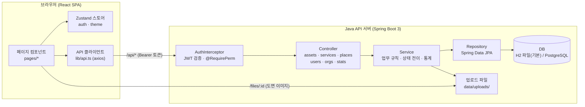
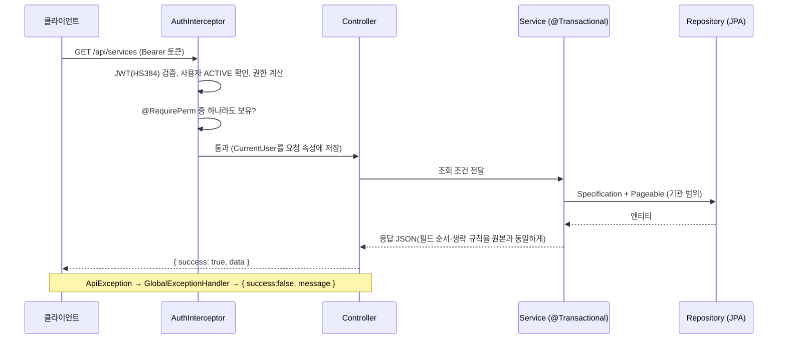
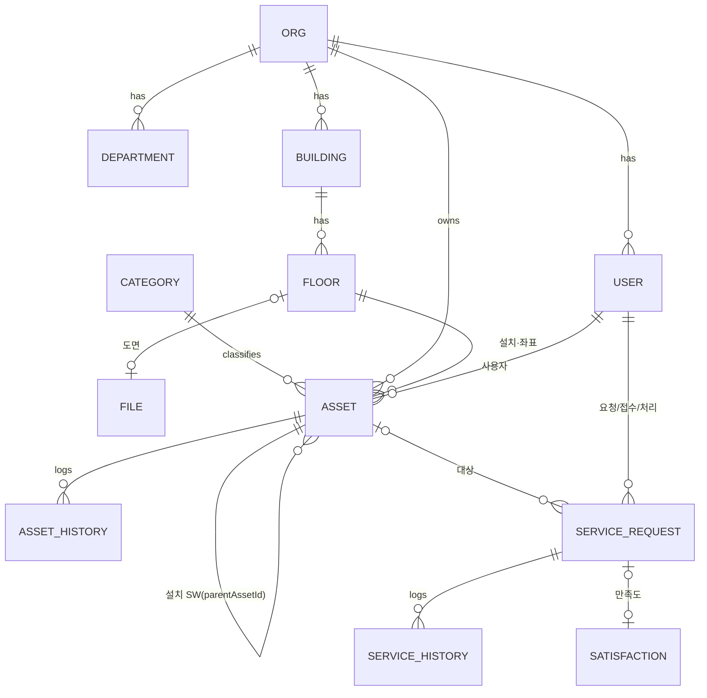

# BingoASM 구현 아키텍처

| 항목 | 내용 |
|---|---|
| 문서 버전 | 2.0 (2026-10-19, 백엔드 Java 전환) |
| 대상 | BingoASM 기관 자산·서비스 관리 시스템 |
| 기준 | 참조 시스템(http://110.10.147.54:5173) 역설계 결과를 바탕으로 재구현한 코드 |

---

## 1. 시스템 개요

BingoASM은 기관이 보유한 IT 자산(하드웨어·설치 소프트웨어)을 등록·관리하고, 자산과 연결된 서비스 요청(장애·문의·설치 등)을 **요청 → 접수 → 배정 → 처리 → 완료 → 종결 → 만족도** 흐름으로 처리하는 웹 시스템입니다.



개발 환경에서는 Vite 개발 서버(5173)가 `/api`, `/files` 요청을 Spring Boot 서버(8080)로 프록시합니다. 운영 환경에서는 실행 JAR 하나가 빌드된 프론트엔드(`client/dist`)까지 함께 서빙하므로 단일 포트로 동작합니다.

---

## 2. 기술 스택

| 계층 | 기술 | 용도 |
|---|---|---|
| UI 프레임워크 | React 18, TypeScript | SPA 화면 구성 |
| 빌드 | Vite 6 | 개발 서버, 번들링, API 프록시 |
| 라우팅 | React Router 6 | 화면 이동, 보호 라우트 |
| 상태 관리 | Zustand 5 | 로그인 사용자(`me`), 권한 확인, 화면 테마 |
| 스타일 | Tailwind CSS 3, shadcn 방식 컴포넌트 | 디자인 토큰(CSS 변수), 라이트/다크 테마 |
| UI 프리미티브 | Radix UI (Dialog, Tabs, Slot) | 접근성 있는 대화상자·탭 |
| 차트 | Recharts | 대시보드·통계 차트 |
| 아이콘 | lucide-react | 아이콘 |
| HTTP | axios | API 호출, 토큰 첨부, 오류 처리 |
| 서버 언어 | Java 17 | 백엔드 |
| 서버 프레임워크 | Spring Boot 3.3 (Spring Web MVC) | REST API, 인터셉터, 예외 처리 |
| 데이터 접근 | Spring Data JPA (Hibernate 6), JPA Specification | 엔티티 매핑, 동적 검색 조건, 페이지네이션 |
| DB | H2 파일 DB (기본, PostgreSQL 호환 모드) / PostgreSQL (`postgres` 프로필) | 데이터 저장 |
| 인증 | jjwt 0.12 (HS384), Spring Security Crypto (BCrypt) | JWT 발급·검증, 비밀번호 해시 |
| 엑셀 | Apache POI 5 (SXSSF) | 목록·통계 xlsx 내보내기 |
| 업로드 | Spring Multipart | 층 도면 이미지 업로드 |
| 빌드 | Maven (mvnw 래퍼 포함) | 실행 JAR 생성 |

---

## 3. 디렉터리 구조

```text
BingoASM/
├─ package.json                 # 루트 스크립트 (install:all, dev:server, dev:client, reset-db)
├─ README.md
├─ docs/                        # 아키텍처 · 기능 정의서 · 원본 대비 검증 보고서
├─ scripts/                     # as_integration_test.py — 원클릭 AS 모듈 통합 테스트(171개 검사)
├─ legacy/docs-archive/         # 이전 버전 문서 (지워도 됨)
│  ├─ index.html                # 테마 선적용 스크립트, 폰트 비차단 로드
│  ├─ vite.config.ts            # @ 별칭, /api·/files 프록시
│  ├─ tailwind.config.js        # darkMode: 'class', 디자인 토큰 매핑
│  └─ src/
│     ├─ main.tsx               # 진입점, 테마 적용
│     ├─ App.tsx                # 라우트 정의, 보호 라우트, 화면 권한 가드
│     ├─ index.css              # 라이트/다크 CSS 변수, status-rail, 차트 테마
│     ├─ lib/
│     │  ├─ api.ts              # axios 인스턴스, get/post/put/patch/del/download/upload
│     │  ├─ constants.ts        # 코드값 ↔ 한글 라벨, 색상 매핑
│     │  ├─ types.ts            # API 응답 타입
│     │  └─ utils.ts            # cn(), 날짜·숫자 포맷
│     ├─ store/
│     │  ├─ auth.ts             # 로그인/로그아웃/세션 복원, can(perm), hasRole(role)
│     │  └─ theme.ts            # light/dark/system 테마 저장·적용
│     ├─ components/
│     │  ├─ layout/             # AppLayout(사이드바·브레드크럼), PageHeader, Pagination, ThemeToggle
│     │  └─ ui/                 # button, input(Field/Select/Textarea), card, badge, table, tabs, dialog
│     └─ pages/                 # 화면 12종 (기능 정의서의 화면 ID와 1:1)
├─ server/                      # 백엔드 (Java 17 + Spring Boot 3, Maven)
│  ├─ pom.xml, mvnw              # 빌드 설정, Maven 래퍼
│  ├─ data/                      # 런타임 생성: H2 DB 파일, uploads/
│  └─ src/main/
│     ├─ resources/
│     │  ├─ application.yml          # 포트, H2, JWT, 업로드 한도, 데이터 폴더
│     │  ├─ application-postgres.yml # PostgreSQL 프로필
│     │  └─ seed/demo-floor-plan.svg # 데모 도면
│     └─ java/com/bingoasm/
│        ├─ BingoAsmApplication.java
│        ├─ common/   # ApiResponse, ApiException, GlobalExceptionHandler, PageResult, Json, Params, AppProperties
│        ├─ auth/     # Roles(ROLE_PERMS), JwtService, AuthInterceptor, @RequirePerm, @PublicApi, CurrentUser
│        ├─ common/   # + CryptoConverter(AES-256-GCM) + CryptoKeyInit, PasswordPolicy, RateLimiter, OpenApiConfig(Swagger)
│        ├─ auth/     # + PermissionService(업체 서비스 유형별 유효 권한), SCHOOL_USER/AS_ENGINEER/VENDOR_ADMIN/EDU_ADMIN 역할
│        ├─ domain/   # JPA 엔티티 14종 + HwDetail/SwDetail 임베디드, Codes
│        │  └─ as/    # 원클릭 AS 엔티티 18종: Region, School, Vendor, SchoolVendor, WirelessDevice, AsRequest, AsHistory,
│        │            #   Post, PostComment, Contact, Room, InventorySession, InventoryScan, AssetNoReservation,
│        │            #   QrLoginSession, OtpChallenge, LoginHistory, MenuScrap, AsCodes
│        ├─ repo/     # Spring Data JPA 리포지토리 (+ repo/as/)
│        ├─ service/  # AssetService, ServiceRequestService, StatsService, PlaceService, UserService, RefData, ExcelWriter
│        │  └─ as/    # SchoolService, WirelessDeviceService, AsRequestService, BoardService, ContactService, AsStatsService,
│        │            #   SpaceService(실·도면), InventoryService(재물조사), QrService(zxing), AssetBulkService(POI), FileService
│        ├─ web/      # REST 컨트롤러 6종 + AuthController(OTP·QR 로그인), WebConfig
│        │  └─ as/    # SchoolController, WirelessDeviceController, AsRequestController, BoardController, ContactController,
│        │            #   AsStatsController, SpaceController, InventoryController, AssetBulkController, QrController, FileController
│        └─ seed/     # DataSeeder(기관·관리자) → AsDataSeeder(학교·업체·기사·장비·실·자산·AS·게시판·문의처) → PiiMigration(평문 개인정보 암호화)
└─ legacy/server-node/          # 이전 Node.js(Express) 서버. 참고용, 같은 API
```

---

## 4. 프론트엔드 구조 (분리됨 — 참고용)

> 프런트엔드는 별도 팀이 새로 만들기로 하여 프로젝트에서 제거했습니다. 아래는 초기 React 화면의 구조를 참고로 남긴 것이며, 새 화면은 서버의 Swagger UI(`/swagger-ui.html`)와 `docs/API_REFERENCE.md`를 기준으로 개발합니다. 서버는 `CORS_ORIGINS`로 허용한 출처(기본 `*`)의 호출을 받습니다.

### 4.1 라우팅과 접근 제어

| 경로 | 화면 | 화면 권한 |
|---|---|---|
| `/login` | 로그인 | 공개 |
| `/` | 대시보드 | 로그인 |
| `/services` | 서비스 목록 | SERVICE_READ |
| `/services/new` | 서비스 요청 | SERVICE_REQUEST |
| `/services/:requestId` | 서비스 상세 | SERVICE_READ |
| `/assets` | 자산 목록 | ASSET_READ |
| `/assets/new` | 자산 등록 | ASSET_WRITE |
| `/assets/:assetId` | 자산 상세 | ASSET_READ |
| `/assets/:assetId/edit` | 자산 수정 | ASSET_WRITE |
| `/floorplan` | 도면 배치 | FLOOR_READ |
| `/stats` | 서비스 통계 | STATS_READ |
| `/users` | 사용자·권한 | USER_READ |
| `/orgs` | 기관·건물 | ORG_READ |

- `Protected` 컴포넌트가 세션 복원(`/api/auth/me`)을 기다린 뒤, 비로그인 사용자를 `/login`으로 보내면서 원래 가려던 경로를 `state.from`에 담습니다. 로그인 성공 시 그 경로로 돌아갑니다.
- `Perm` 컴포넌트가 화면 단위 권한을, 각 화면 내부의 `can(perm)`이 버튼 단위 권한을 제어합니다. 최종 권한 판단은 항상 서버가 다시 합니다.
- 사이드바 메뉴는 권한이 있는 항목만 보입니다.

### 4.2 API 클라이언트 (`lib/api.ts`)

- 모든 요청에 `Authorization: Bearer <accessToken>`을 붙입니다 (`localStorage: asm.accessToken`).
- 응답 형식은 `{ success, data }`이며, 헬퍼는 `data`만 돌려줍니다.
- 401 응답이면 refresh 토큰으로 한 번 재발급을 시도하고, 실패하면 토큰을 지우고 로그인 화면으로 이동합니다.
- 오류 메시지는 서버의 `message`를 그대로 `Error`로 던져 화면에 표시합니다. 엑셀 다운로드(Blob) 오류도 메시지를 해석합니다.
- `download()`는 `Content-Disposition`의 UTF-8 파일명을 읽어 저장합니다. `upload()`는 multipart로 전송합니다.

### 4.3 상태 관리

| 스토어 | 상태 | 주요 함수 |
|---|---|---|
| `useAuth` | `me`(사용자·역할·권한), `loading` | `login`, `logout`, `restore`, `can(perm)`, `hasRole(role)` |
| `useTheme` | `theme`(light/dark/system) | `setTheme`, OS 설정 변경 감지 |

화면 데이터는 전역 스토어에 두지 않고 각 페이지가 API로 직접 조회합니다 (조회 조건 → 결과 → 페이지네이션).

### 4.4 디자인 시스템과 테마

- 색상은 `index.css`의 CSS 변수(`--background`, `--primary` 등)로 정의하고 Tailwind 토큰에 연결했습니다. `:root`가 라이트, `.dark`가 다크 값입니다.
- `index.html`의 인라인 스크립트가 첫 화면 그리기 전에 저장된 테마를 적용해 깜박임을 막습니다.
- 서비스 상태는 고유 색(`SERVICE_STATUS_COLOR`)을 가지며 배지, 진행 단계, 목록 왼쪽 상태 레일(`.status-rail`)에 공통으로 쓰입니다.
- 숫자·코드(자산번호, 요청번호, 좌표)는 등폭 글꼴(`.tabular`)로 표시합니다.

---

## 5. 백엔드 구조

### 5.1 요청 처리 흐름



### 5.2 인증

| 항목 | 내용 |
|---|---|
| 로그인 | `POST /api/auth/login` — 아이디, 비밀번호, 기관 코드(선택) |
| 토큰 | access 8시간, refresh 14일 (HS384 — 참조 시스템과 동일, `JWT_SECRET` 환경변수 48바이트 이상) |
| 비밀번호 | bcrypt 해시 저장, 평문 미보관 |
| 계정 잠금 | 5회 연속 실패 시 `LOCKED`, 관리자가 상태를 `ACTIVE`로 바꾸면 해제 |
| 세션 복원 | `GET /api/auth/me` |

### 5.3 권한 모델 (RBAC)

사용자는 여러 역할을 가질 수 있고, 권한은 역할 권한의 합집합입니다 (`server/src/main/java/com/bingoasm/auth/Roles.java`의 `ROLE_PERMS`). 컨트롤러 메서드의 `@RequirePerm`이 필요한 권한을 선언합니다.

| 권한 | 요청자 | 접수자 | 처리자 | 시스템 관리자 | 통합 관리자 |
|---|:-:|:-:|:-:|:-:|:-:|
| SERVICE_REQUEST | ● | | | ● | |
| SERVICE_READ | ● | ● | ● | ● | |
| SERVICE_RECEIVE | | ● | | ● | |
| SERVICE_PROCESS | | | ● | ● | |
| SERVICE_CLOSE | | ● | | ● | |
| SATIS_WRITE | ● | | | ● | |
| ASSET_READ | ● | ● | ● | ● | |
| ASSET_WRITE | | | ● | ● | |
| ASSET_DELETE | | | | ● | |
| FLOOR_READ | ● | ● | ● | ● | |
| FLOOR_WRITE | | | ● | ● | |
| STATS_READ | | ● | | ● | |
| STATS_EXPORT | | | | ● | |
| USER_READ | | ● | | ● | |
| USER_WRITE | | | | ● | |
| ROLE_GRANT | | | | ● | |
| ORG_READ | | | | ● | ● |
| ORG_WRITE | | | | | ● |

> 참조 시스템의 백엔드 코드는 공개되지 않아, 역할별 권한은 화면의 권한 검사와 역할 설명(`ROLE_DESC`)을 근거로 추정했습니다. 관리자 계정의 권한 목록 18종은 참조 시스템 응답과 일치합니다.

### 5.4 데이터 저장소

- 기본은 H2 파일 DB(`server/data/bingoasm.mv.db`)입니다. 따로 설치할 것이 없고, PostgreSQL 호환 모드로 동작합니다.
- 운영에서는 `SPRING_PROFILES_ACTIVE=postgres`와 `DB_URL`, `DB_USER`, `DB_PASSWORD`로 PostgreSQL을 씁니다. 코드 변경은 없습니다. PostgreSQL 16에서 전체 기능을 검증했습니다.
- 로컬 PostgreSQL은 `docker-compose.yml`로 띄웁니다 (`npm run db:up`, 계정 bingoasm/bingoasm, 포트 5432, 데이터는 Docker 볼륨 `bingoasm-pgdata`).
- 테이블은 JPA 엔티티로부터 자동 생성됩니다(`ddl-auto=update`). 운영에서 스키마를 엄격히 관리하려면 Flyway 같은 마이그레이션 도구로 바꾸는 것을 권장합니다.
- DB가 비어 있으면 `DataSeeder`가 참조 시스템과 같은 데모 데이터를 넣습니다. ID 순서까지 원본과 같게 맞췄습니다.
- 엔티티 사이 관계는 JPA 연관관계 대신 ID 컬럼(예: `assetId`, `processorId`)으로 저장하고, 이름 조회는 `RefData`가 요청마다 기관의 참조 테이블을 한 번에 읽어 처리합니다(N+1 조회 방지).
- 목록 검색은 JPA Specification으로 조건을 조합하고 DB에서 정렬·페이지네이션합니다. 서비스 검색어는 자산번호를 서브쿼리로 함께 찾습니다.

### 5.5 데이터 모델



| 엔티티 | 주요 필드 |
|---|---|
| Org | orgId, orgCode, orgName, bizNo, repName, tel, address |
| Department | deptId, orgId, deptName, sortOrder |
| User | userId, orgId, deptId, loginId, password(해시), userName, positionName, email, mobile, status(ACTIVE/LOCKED/DISABLED), loginFailCnt, lastLoginAt, roles[] |
| Building | buildingId, orgId, buildingName, zipCode, address, addressDetail |
| Floor | floorId, buildingId, floorNo(지하는 음수), floorName, sortOrder, planFileId |
| File | fileId, storedName, originalName, mimeType, size |
| Category | categoryId, assetType(HW/SW), categoryName, sortOrder |
| Asset | assetId, assetNo, assetType, categoryId, assetName, manufacturer, modelName, serialNo, spec, acquiredAt, acquirePrice, warrantyEnd, status, buildingId, floorId, locationDetail, posX, posY(도면 %좌표), ownerUserId, deptId, parentAssetId, note, useYn |
| Asset.hw (임베디드, hw_* 컬럼) | hostName, cpu, memory, disk, osName, ipAddress, macAddress |
| Asset.sw (임베디드, sw_* 컬럼) | version, publisher, licenseType, licenseKey, licenseCount, licenseStart, licenseEnd |
| AssetHistory | historyId, assetId, actionType(CREATE/UPDATE/STATUS/LOCATE/DELETE), content, workerId, createdAt |
| ServiceRequest | requestId, requestNo, assetId, requestType, priority, title, content, status, requesterId, requestAt, contactTel, buildingId, floorId, locationDetail, receiverId, receivedAt, processorId, assignedAt, dueAt, startedAt, completedAt, causeCode, actionCode, actionContent, workMinutes, closedAt, holdReason, rejectReason |
| Satisfaction (satisfactions 테이블, requestId 유일) | satisId, requestId, overallScore, kindnessScore, speedScore, expertiseScore(1~5), comment, surveyedBy, surveyedAt |
| ServiceHistory | historyId, requestId, prevStatus, status, content, workerId, createdAt |

### 5.6 공통 API 규칙

| 규칙 | 내용 |
|---|---|
| 응답 | 성공 `{ "success": true, "data": ... }`, 실패 `{ "success": false, "message": "..." }` |
| 상태 코드 | 400 입력 오류, 401 미인증, 403 권한 없음, 404 없음, 409 상태 충돌·중복, 423 계정 잠금, 500 서버 오류 |
| 목록 | `page`(1부터), `size`, `sort`(예: `request_at desc`) → `{ content, totalElements, page, size, totalPages }` |
| 생성 | `POST /api/assets`, `POST /api/services`는 새 ID(숫자)를 반환 |
| 기관 범위 | 모든 조회·변경은 로그인 사용자의 `orgId`로 제한 |
| 엑셀 | xlsx 바이너리, `Content-Disposition: attachment; filename*=UTF-8''...` |

### 5.7 API 목록

| 메서드 | 경로 | 권한 | 설명 |
|---|---|---|---|
| POST | /api/auth/login | 공개 | 로그인, 토큰과 사용자 정보 반환 |
| POST | /api/auth/refresh | 공개 | refresh 토큰으로 재발급 |
| GET | /api/auth/me | 로그인 | 현재 사용자·역할·권한 |
| GET | /api/services | SERVICE_READ | 서비스 목록 (keyword, status, statusGroup, requestType, priority, fromDate, toDate, assetId, myRequest, myTask) |
| GET | /api/services/dashboard | SERVICE_READ | 대시보드 집계 10종 |
| GET | /api/services/excel | SERVICE_READ | 서비스 목록 엑셀 |
| GET | /api/services/:id | SERVICE_READ | 상세 + 처리 이력 + 만족도 |
| POST | /api/services | SERVICE_REQUEST | 서비스 요청 등록 → requestId |
| POST | /api/services/:id/receive | SERVICE_RECEIVE | 접수 |
| POST | /api/services/:id/assign | SERVICE_RECEIVE | 처리자 배정 `{ processorId, dueAt, memo }` |
| POST | /api/services/:id/start | SERVICE_PROCESS | 처리 시작·재개 |
| POST | /api/services/:id/hold | SERVICE_PROCESS | 보류 `{ reason }` |
| POST | /api/services/:id/complete | SERVICE_PROCESS | 처리 완료 `{ causeCode, actionCode, actionContent, workMinutes }` |
| POST | /api/services/:id/close | SERVICE_CLOSE | 종결 |
| POST | /api/services/:id/reject | SERVICE_RECEIVE | 반려 `{ reason }` |
| POST | /api/services/:id/satisfaction | 요청자 본인 | 만족도 `{ overallScore, kindnessScore, speedScore, expertiseScore, comment }` |
| GET | /api/assets | ASSET_READ | 자산 목록 (keyword, assetType, categoryId, status, buildingId, floorId, acquiredFrom, acquiredTo, unplacedOnly) |
| GET | /api/assets/summary | ASSET_READ | 분류별·상태별 수량 |
| GET | /api/assets/categories | 로그인 | 자산 분류 |
| GET | /api/assets/excel | ASSET_READ | 자산 목록 엑셀 |
| GET | /api/assets/by-floor/:floorId | FLOOR_READ 또는 ASSET_READ | 층에 배치된 자산 |
| GET | /api/assets/:id | ASSET_READ | 상세 + hw/sw + installedSoftware |
| GET | /api/assets/:id/histories | ASSET_READ | 자산 이력 |
| POST | /api/assets | ASSET_WRITE | 자산 등록 → assetId |
| PUT | /api/assets/:id | ASSET_WRITE | 자산 수정 |
| PATCH | /api/assets/:id/position | FLOOR_WRITE | 도면 좌표 지정·해제 `{ floorId, posX, posY }` |
| DELETE | /api/assets/:id | ASSET_DELETE | 자산 삭제(논리 삭제) |
| GET | /api/places/buildings | 로그인 | 건물 + 층 목록 |
| POST | /api/places/buildings | FLOOR_WRITE 또는 ORG_WRITE | 건물 등록 |
| POST | /api/places/floors | FLOOR_WRITE·ORG_WRITE·ROLE_GRANT | 층 등록 |
| GET | /api/places/floors/:id | 로그인 | 층 상세 |
| POST | /api/places/floors/:id/plan | FLOOR_WRITE | 도면 이미지 업로드 (20MB, 이미지 형식) |
| GET | /files/:id | 공개 | 도면 이미지 |
| GET | /api/users | USER_READ 또는 ASSET_WRITE | 사용자 목록 (keyword, deptId, role, status) |
| GET | /api/users/processors | 로그인 | 처리자 목록 |
| POST | /api/users | USER_WRITE | 사용자 등록 |
| PUT | /api/users/:id | USER_WRITE | 사용자 수정 |
| PUT | /api/users/:id/roles | ROLE_GRANT | 역할 부여 |
| GET | /api/orgs | ORG_READ | 기관 목록 (통합 관리자는 전체) |
| GET | /api/orgs/departments | 로그인 | 부서 목록 |
| GET | /api/stats/services | STATS_READ | 서비스 통계 (period, fromDate, toDate, requestType) |
| GET | /api/stats/services/excel | STATS_READ 또는 STATS_EXPORT | 통계 엑셀 (시트 5개) |

---

## 6. 실행과 배포

| 구분 | 명령 | 설명 |
|---|---|---|
| 의존성 설치 | `npm run install:all` | client npm 설치, server Maven 의존성 미리 받기 |
| API 개발 서버 | `npm run dev:server` | `./mvnw spring-boot:run`, 8080 |
| UI 개발 서버 | `npm run dev:client` | 5173, API 프록시 |
| 운영 빌드 | `npm run build` | `client/dist` + `server/target/bingoasm-server.jar` |
| 운영 실행 | `npm start` | `java -jar` 하나로 API + UI를 8080에서 서빙 |
| PostgreSQL 실행 | `npm run db:up` / `npm run db:down` | Docker로 PostgreSQL 16 시작·중지 |
| API 개발 서버 (PostgreSQL) | `npm run dev:server:pg` | `postgres` 프로필로 실행 |
| 데이터 초기화 | `npm run reset-db` / `npm run reset-db:pg` | 서버를 끈 뒤 실행, 다음 시작 시 데모 데이터 재생성 (H2 / PostgreSQL) |

| 환경 변수 | 기본값 | 설명 |
|---|---|---|
| `PORT` | 8080 | API 서버 포트 |
| `JWT_SECRET` | 개발용 값 | 48바이트 이상. 운영에서는 반드시 변경 |
| `DATA_DIR` | ./data | H2 DB 파일과 업로드 폴더 |
| `SPRING_PROFILES_ACTIVE` | (없음) | `postgres`로 PostgreSQL 사용 |
| `DB_URL` / `DB_USER` / `DB_PASSWORD` | localhost 기본값 | PostgreSQL 접속 정보 |
| `CLIENT_DIST` | ../client/dist | API 서버가 함께 서빙할 빌드된 UI 위치 |
| `API_URL` | http://localhost:8080 | Vite 프록시 대상 |

요구 사항: Java 17 이상, Node.js 20 이상. Maven은 `mvnw`가 자동으로 받습니다.

## 7. 보안 고려 사항

- 운영 배포 전 `JWT_SECRET`을 바꾸고 HTTPS 뒤에 두어야 합니다.
- 비밀번호는 bcrypt로 해시하고 응답에서 제외합니다.
- 모든 변경 API는 서버에서 권한(`@RequirePerm`, 서비스 내부 검사)과 현재 상태를 다시 검증합니다. 화면 권한 제어는 편의 기능입니다.
- 모든 조회·변경 쿼리는 로그인 사용자의 기관(orgId)으로 제한합니다.
- 업로드는 이미지 형식(PNG·JPEG·GIF·WEBP·SVG)과 20MB로 제한하고, 저장 파일명은 무작위로 생성합니다. 파일 응답에는 `X-Content-Type-Options: nosniff`를 붙입니다.
- `/files/:id`는 `` 표시를 위해 인증 없이 열려 있습니다. 민감한 도면이라면 서명 URL이나 쿠키 인증으로 바꾸는 것을 권장합니다.
- 토큰은 `localStorage`에 저장합니다. XSS 위험을 더 줄이려면 HttpOnly 쿠키 방식으로 바꿀 수 있습니다.

---

## 8. 확장 포인트

| 항목 | 방법 |
|---|---|
| 데이터베이스 | PostgreSQL 프로필 제공. 스키마 이력 관리는 Flyway 도입 권장 |
| 다기관 운영 | 통합 관리자용 기관 등록·전환 API 추가 (`ORG_WRITE` 권한은 이미 정의) |
| 알림 | `ServiceRequestService.act()`의 상태 전이 지점에서 메일·메신저 발송 추가 |
| 모바일 | 반응형 레이아웃 적용됨. 참조 시스템의 safe-area 대응처럼 Capacitor 패키징 가능 |
| 코드 분할 | 페이지 단위 `React.lazy`로 번들 크기 축소 (현재 단일 번들 약 800KB) |

---

## 9. 원클릭 AS 모듈 (충북교육청 원클릭 AS 역설계)

https://www.cbe.go.kr/as/main.do 를 역설계해 같은 백엔드에 모듈로 얹었습니다. 상세 명세는 [API_REFERENCE.md](API_REFERENCE.md), 동료 UI 검토는 [FRONTEND_GUIDE.md](FRONTEND_GUIDE.md).

```text
학교 담당자 ──신청──▶ AsRequest(A) ──접수(방문예정)──▶ R ──처리 보고서──▶ C ──만족도──▶ 평가 완료
   │                      │  반려(X) ⇄ 반려취소          │ 이관(다른 유형 업체로, A로 복귀)
   │                      └── 학교×유형 → 업체·기사 자동 배정 (school_vendors)
   ├─ 도면: 건물 → 층(이미지) → 실(rect %) → 자산 (실 QR /r/{id}, 자산 라벨 QR /a/{assetNo})
   ├─ 재물조사: 실 선택 → 라벨 스캔 → FOUND / MOVED / UNKNOWN → 보고서 → 이동 반영
   └─ 일괄 등록: 양식(xlsx) → 검증(행별 오류) → 확정(자동 채번·실 연결)
업체 기사/관리자 ── 권한은 업체 serviceTypes(C,M,S,T)에서 로그인 때 계산 (접근권한표와 동일)
교육청 관리자 ── 학교·지역·업체·장비·게시판·문의처·통계, OTP 2단계
```

| 관심사 | 구현 |
|---|---|
| 역할·권한 | `Roles`에 4개 역할 추가, `PermissionService.effectivePerms()`가 업체 서비스 유형별 `AS_{ty}_REQUEST/_VIEW`를 더함. 컨트롤러 `@RequirePerm` + 서비스 스코프(학교/업체/전체) 이중 검사 |
| 계정 보안 | BCrypt 12, `PasswordPolicy`, `CryptoConverter`(이메일·휴대폰 AES-256-GCM, 키 `DATA_KEY`; 키는 정적 초기화 + `CryptoKeyInit`로 Hibernate 생성 순서와 무관하게 준비, 기동 시 `PiiMigration`이 평문 행을 암호화), 5회 실패 30분 잠금, `RateLimiter`(IP당 분당 20회), OTP(해시·1회용·5분), QR 로그인 세션(3분·1회 발급), 로그인 이력(IP 마스킹) |
| 상태 기계 | `AsRequestService.allowedActions()`가 (상태 × 역할 × 소유)로 가능한 처리를 계산하고 `act()`가 같은 표로 검사 → 화면은 `allowedActions`만 보고 버튼을 그림 |
| 도면·위치 | 기존 Building/Floor(도면 이미지) 위에 `Room`(rect %) 추가, `Asset.schoolId/roomId`. 실 QR·자산 라벨 QR은 zxing으로 생성 |
| 재물조사 | `InventorySession` + `InventoryScan`(FOUND/MOVED/UNKNOWN), 보고서는 완료한 실만 미확인을 계산, `applyMoves`가 `SpaceService.moveAssets`로 이력까지 남김 |
| 일괄 등록 | Apache POI로 양식 생성(데이터 유효성 드롭다운)·읽기, 파일과 JSON 행 둘 다 같은 `validateRows()` 로 검증 후 `AssetService.create()` 재사용 |
| 데이터 | 테이블 18개 추가, 기존 테이블 컬럼 추가(`ddl-auto: update`로 H2·PostgreSQL 모두 제자리 업그레이드 확인) |

